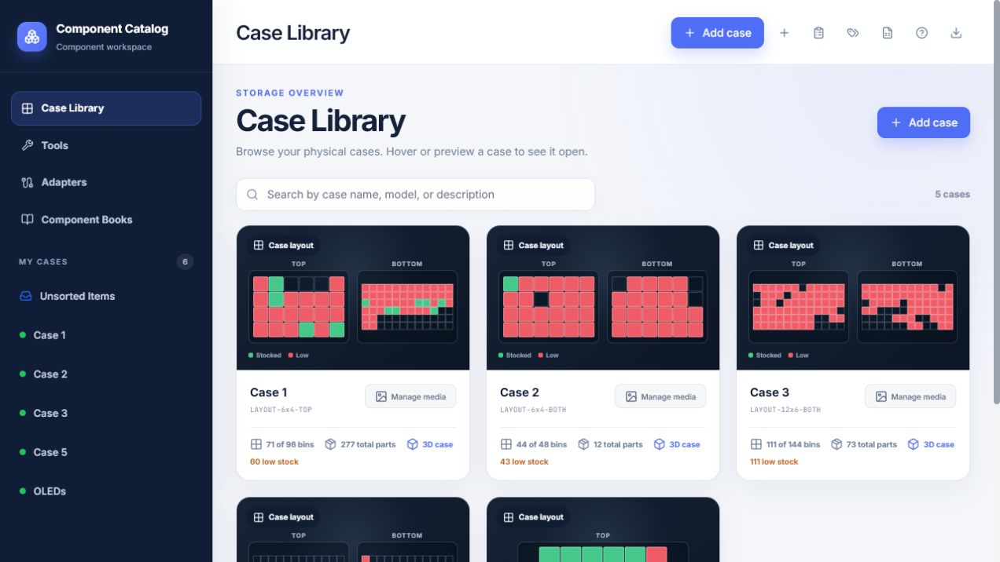
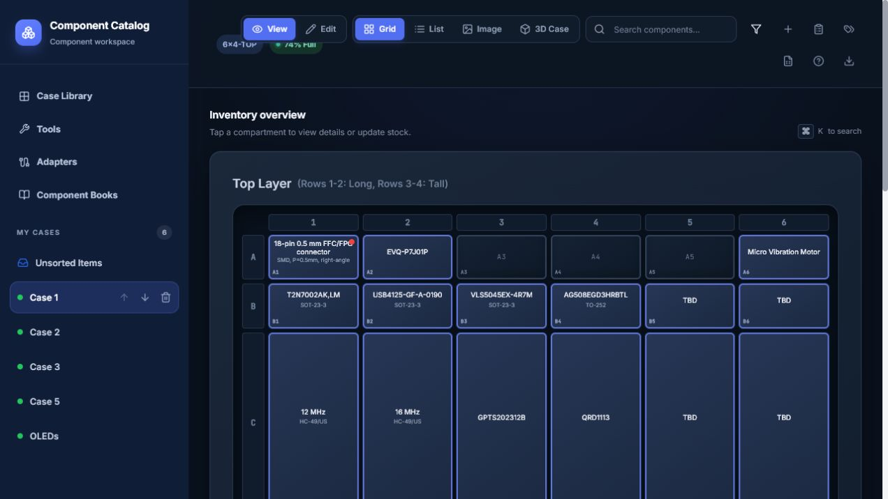
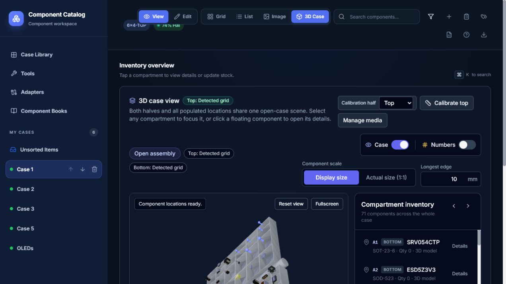
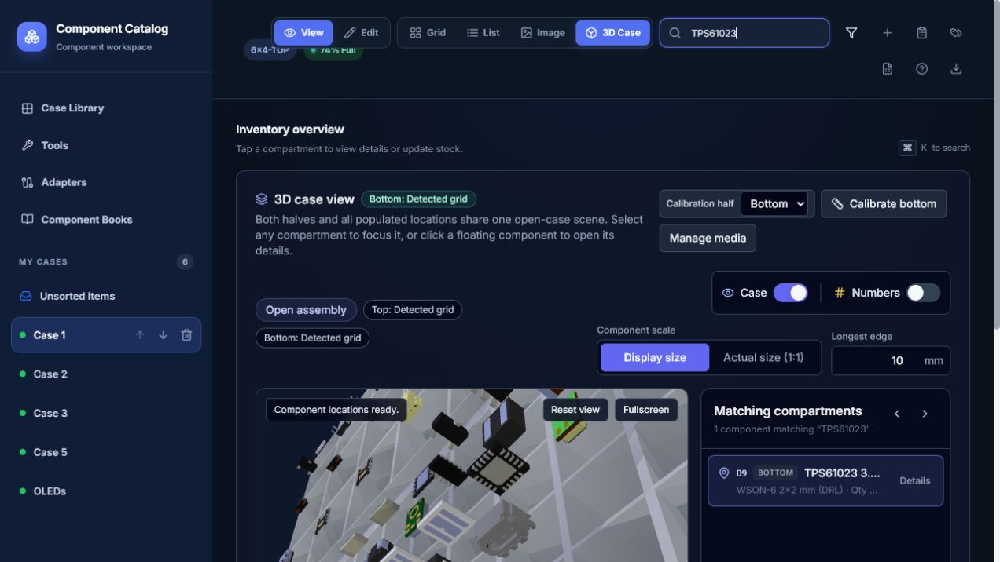
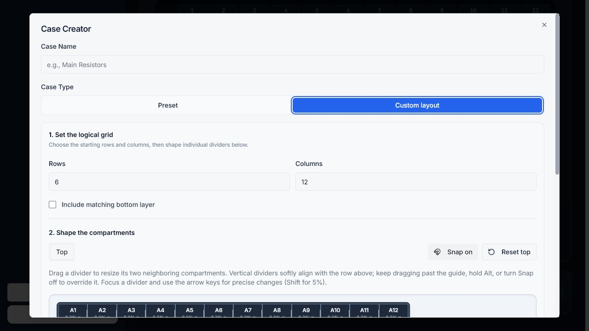
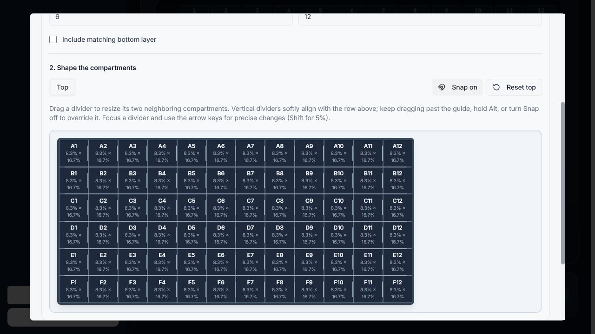

# Component Catalog

Component Catalog is a local-first web application for organizing electronic
components, storage cases, assortment books, bench tools, and adapters. It
combines physical-location tracking with search, stock controls, printable
labels, BOM matching, uploaded media, and optional 3D models.


## Screenshots



*Case Library overview with layout previews, occupancy, and stock status.*

| Inventory grid | 3D case locator |
| --- | --- |
|  |  |
| Browse components by physical compartment. | Locate stocked parts in the calibrated 3D case view. |

| Search in context | Custom case creator |
| --- | --- |
|  |  |
| Search by part and jump to its exact case location. | Define case dimensions and shape compartment dividers. |



*The custom layout editor supports snap guides, keyboard adjustments, and
unequal compartment sizes.*

## Features

- Storage cases with top and bottom layers, custom rows and columns, an
  Unsorted holding area, and a drag-resizable custom-layout designer.
- Grid, physical, library, and 3D case views with compartment-level locations.
- Component records with category, package, quantity, minimum stock, notes,
  datasheet/photo references, current checkout status, and optional 3D model.
- Global search across loose components, assortment-book contents, and
  adapters. Loose-component search covers name, package, and notes; books add
  value and part-number fields.
- Bulk quantity editing with search, stock-state filters, increment/decrement
  controls, and debounced saving.
- Printable component-label and placement-code sheets with case, search, size,
  cut-guide, and starting-offset controls.
- CSV, TSV, TXT, and JSON BOM matching with printable HTML and PDF location
  reports.
- Separate inventories for bench tools, physical adapters, and indexed
  component books.
- JSON import/export for catalog records, with replace and add-as-new modes.
- Case photos, downloaded or uploaded component media, and managed GLB assets.
- STEP, STP, and WRL conversion through KiCad's CLI, plus local KiCad model
  library search.
- A read-only, OAuth-protected MCP service for private ChatGPT inventory
  lookup.

Component checkout records the current borrower and checkout time. It does not
maintain a historical checkout ledger.

## Requirements

- Node.js 20.19 or newer
- npm
- A modern Chromium, Firefox, or Safari browser
- Windows for the included double-click launchers and LAN-launcher test
- Optional: KiCad with `kicad-cli` for STEP/STP/WRL conversion and library
  search
- Optional: PostgreSQL when JSON-file storage is not appropriate

## Quick start

From the repository directory:

```powershell
npm ci
npm run dev
```

Open the URL printed by the server. The app prefers
`http://127.0.0.1:5000`; if that port is occupied, it tries the next available
localhost port while reserving the phone/MCP port, which defaults to 5002.

For a production build:

```powershell
npm run build
npm start
```

`npm start` expects `npm run build` to have completed.

### Windows launchers

After installing dependencies once with `npm ci`, these launchers are
available:

- `Launch Component Catalog.cmd` starts the local development app and opens
  the actual selected URL.
- `Launch Component Catalog on Local Network.cmd` builds and exposes the full
  application to one trusted Windows Private network.
- `Launch Component Catalog Phone Access.cmd` starts the local app plus the
  separate read-only MCP service after its optional configuration is complete.

The launchers identify an existing Component Catalog process and do not mistake
an unrelated service on port 5000 for this application.

## Storage, privacy, and backups

JSON-file storage is the default. PostgreSQL is optional.

| Data | Default location | Override |
| --- | --- | --- |
| Catalog state | `data/storage.json` | `STORAGE_FILE` |
| Managed photos, datasheets, models, case images, and reports | `uploads/` | `UPLOADS_DIR` |
| KiCad settings | `data/kicad-settings.json` | `KICAD_SETTINGS_FILE` |
| Temporary model conversion files | Operating-system temp directory | `MODEL_TEMP_DIR` |

The application creates missing JSON storage and upload directories on first
run. Runtime state and uploaded assets are personal data and are ignored for
new source repositories.

To keep private data outside the source checkout:

```powershell
$env:STORAGE_FILE = 'D:\ComponentCatalogData\storage.json'
$env:UPLOADS_DIR = 'D:\ComponentCatalogData\uploads'
$env:KICAD_SETTINGS_FILE = 'D:\ComponentCatalogData\kicad-settings.json'
npm run dev
```

Use paths appropriate for your machine. Do not commit `.env.phone.local`,
tokens, inventory exports, or runtime storage to a public repository.

### Exact backup

For a consistent JSON-storage backup:

1. Stop the Component Catalog server so no write is in progress.
2. Copy `storage.json`.
3. Copy the entire managed `uploads` directory.
4. Copy `kicad-settings.json` if its machine-specific library configuration is
   useful on the destination.

On Windows, the backup helper creates a dated ZIP and refuses to run while a
JSON-storage lock exists:

```powershell
powershell -NoProfile -ExecutionPolicy Bypass -File scripts/backup-component-catalog.ps1 `
  -DestinationDirectory 'D:\Backups\ComponentCatalog'
```

The destination may be a private Google Drive-synced folder. The helper prints
the archive's SHA-256 hash after a successful write.

The in-app JSON export contains catalog records and managed-asset URLs, not the
binary files behind those URLs. A portable export therefore also needs the
entire `uploads` directory—not only `uploads/models`. Import validates managed
asset references and refuses to claim success when referenced files are
missing. Active checkout state is not restored by catalog import.

For PostgreSQL, back up the database and the managed uploads directory.

Google Drive or another private cloud folder is suitable for dated/versioned
backup snapshots. It is not a distributed database: if a synchronized folder
is used as active JSON storage, only one computer should run the app and write
that catalog at a time. For concurrent multi-machine use, use PostgreSQL
instead.

## Using the catalog

### Cases and components

1. Open **Case Library** and create or select a case.
2. Switch the case workspace to **Edit** before selecting an empty compartment
   to add a component.
3. Add the part name, category, quantity, minimum quantity, package, notes, and
   optional media.
4. Use Edit mode's copy/paste workflow to copy a component into another
   compartment. The source remains in place; replacing an occupied target
   requires confirmation.

The dashboard counts occupied component records in the selected case, total
quantity, low-stock records, and empty compartments. A red status marks low
stock and orange marks a currently checked-out component.

### Search

The header search opens a combined results page:

- Loose components match name, package, and notes and show exact case,
  compartment, and layer.
- Component-book items add value and part-number matching and are labeled as
  book stock rather than loose inventory.
- Adapters are included for relevant connection, package, and compatibility
  queries.

Category filtering can be combined with case search.

### Quantity editor

Open **Edit Quantities** from the toolbar to search and filter stocked
components across cases. Type an absolute nonnegative quantity or use the
increment/decrement controls. Changes save after a short delay and show their
pending, saved, or error state.

### Labels

Open **Print Labels** from the toolbar. Select all cases or one case, then
filter by label size or search text. The page can print component labels or
placement codes and supports cut-guide styles and an offset for partially used
label stock.

### BOM locator

Open **BOM Locator** and upload a CSV, TSV, TXT, or JSON file up to 2 MiB. The
deterministic matcher runs locally against loose inventory and component-book
contents, then produces:

- matched and missing parts;
- exact case, compartment, and layer locations;
- a browser report; and
- a printable PDF report.

AI analysis is off unless one of `HF_TOKEN`, `HUGGINGFACE_API_KEY`, or
`HUGGINGFACEHUB_API_TOKEN` is present. When enabled, the BOM report payload is
sent to the Hugging Face inference router for an optional summary. Leave those
variables unset when BOM or inventory information must remain entirely local.
`HF_INFERENCE_MODEL` selects a different compatible model.

### Import and export

Use the toolbar's import and export controls for catalog records. Imports can
replace existing records or add imported records as new items. The importer
accepts cases, compartments, components, tools, adapters, component books, and
nested book contents.

[`example-import.json`](./example-import.json) is a synthetic, directly
importable example. It demonstrates the import shape; it is not an exact dump
of the internal JSON-storage file.

Managed assets are referenced by paths such as
`/uploads/models/<sha256>.glb`. Restore the corresponding upload files before
importing data that references them.

### Case media and 3D models

Case cards can have a closed photo, an optional open photo, and independent top
and bottom GLB models. Preset cases use models from `default-cases` until a
half is intentionally replaced or removed.

Components accept:

- native GLB uploads;
- STEP, STP, or WRL uploads converted through `kicad-cli`; or
- models selected from an indexed local KiCad library.

Only the validated GLB is retained after conversion. Model uploads are limited
to 50 MiB. Case images and other managed image/datasheet uploads are limited
to 10 MiB. Individual component model orientation can be saved in 90-degree
steps around X, Y, and Z.

The 3D case locator uses named anchors or calibrated case grids. Components
without a usable model remain accessible as compact location pins.

## Network access and security

The full web application has no user authentication. Its REST API can create,
change, move, and delete catalog records.

### Local mode

The server binds to `127.0.0.1` by default. This is the recommended mode and
keeps the full UI, local uploads, and KiCad metadata off the network.

### Trusted-LAN mode

`Launch Component Catalog on Local Network.cmd`:

- selects a single active physical adapter with a Windows **Private** network
  profile and default gateway;
- ignores public, VPN, virtual, and off-gateway addresses;
- binds to that adapter's specific private IPv4 address;
- applies Host-header and cross-site request checks; and
- stops when it cannot select one unambiguous trusted adapter.

Any device that can reach the displayed URL can view and change the catalog,
including deleting data. Use this only on a trusted home/private LAN, allow
Node.js through Windows Firewall on Private networks only, and close the
server window when finished. Do not deploy the full UI directly to the public
internet.

### Optional read-only ChatGPT MCP access

This is separate from the full LAN UI. The MCP service exposes four read-only
tools:

- `search_inventory`
- `search_component_books`
- `list_tools`
- `list_adapters`

The service defaults to `127.0.0.1:5002`, requires OAuth for tool calls, and
does not expose the catalog REST API.

One-time setup:

1. Install and authenticate the ngrok agent.
2. Configure an Auth0 API and regular web application for Authorization Code
   flow.
3. Give the API an `inventory:read` permission.
4. Copy `.env.phone.example` to `.env.phone.local`.
5. Replace every placeholder. The Auth0 audience must match the protected MCP
   resource URL, including `/mcp`.
6. Run `Launch Component Catalog Phone Access.cmd`.
7. Connect the resulting HTTPS `/mcp` URL as an OAuth-enabled developer-mode
   ChatGPT app and confirm all four tools are read-only.

Example configuration:

```dotenv
PHONE_ACCESS_ENABLED=true
PHONE_ACCESS_HOST=127.0.0.1
PHONE_ACCESS_PORT=5002
MCP_PUBLIC_URL=https://YOUR-ASSIGNED-DOMAIN.ngrok-free.app
AUTH0_ISSUER=https://YOUR-TENANT.us.auth0.com/
AUTH0_AUDIENCE=https://YOUR-ASSIGNED-DOMAIN.ngrok-free.app/mcp
AUTH0_SCOPE=inventory:read
```

The phone lookup works only while the home computer, catalog server, MCP
service, and tunnel are running. Health and OAuth discovery are public; tool
calls require a valid access token.

Useful checks:

```powershell
npm run test:phone
Invoke-RestMethod http://127.0.0.1:5002/health
npx @modelcontextprotocol/inspector@latest --server-url http://127.0.0.1:5002/mcp --transport http
```

Use the Inspector's authentication settings for a successful local tool call.

## Optional PostgreSQL storage

Set `STORAGE_BACKEND=postgres` and provide `DATABASE_URL` before starting the
app. For a new database, synchronize the full schema:

```powershell
npm run db:push
```

The numbered SQL files under `migrations/` are incremental upgrades for older
databases; they are not a complete blank-database bootstrap on their own.
Managed uploads remain filesystem data and still require backup.

## Development and verification

The application uses React, TypeScript, Vite, Express, TanStack Query, Drizzle
ORM, and Tailwind CSS.

Run the main verification sequence before submitting a change:

```powershell
npm run check
npm test
npm run build
```

Focused checks:

```powershell
npm run test:3d
npm run test:phone
npm run test:lan-launcher
python -m unittest skills/component-catalog/scripts/test_component_catalog.py
```

`test:lan-launcher` requires Windows. The main application tests create
isolated temporary storage and uploads rather than modifying the live catalog.

See [`CONTRIBUTING.md`](./CONTRIBUTING.md) for privacy rules, the pull-request
workflow, and change-specific verification.

## Known boundaries

- The full UI is intended for local or trusted-LAN use and has no sign-in.
- JSON-file storage supports one active writer, not concurrent distributed
  editing.
- JSON imports and exports do not embed managed binary assets.
- Checkout tracks current state, not history.
- STEP/STP/WRL conversion and KiCad library search require a local KiCad
  installation; native GLB uploads do not.
- The app requires a running server and does not provide offline browser
  support.


## License

Component Catalog is released under the
[Zero-Clause BSD license](./LICENSE) (`0BSD`), including the three original
bundled case GLBs in `default-cases/`, unless a file explicitly says otherwise.
Third-party dependencies and incorporated source retain their own licenses;
see [`THIRD_PARTY_NOTICES.md`](./THIRD_PARTY_NOTICES.md). Included non-code
assets are documented in [`ASSET_PROVENANCE.md`](./ASSET_PROVENANCE.md).
